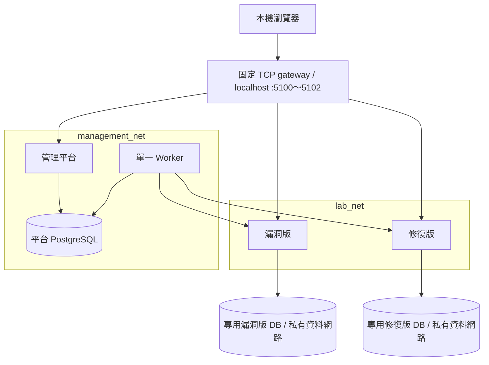

# 架構與規格對照

實驗與資料網路使用 internal。只有 gateway 加入一般 ingress 網路及發布 localhost 埠，並以固定目標轉送三個 Web 服務、關閉 IP forwarding。Worker 不接入 TaskBoard 資料庫網路，管理平台不接入 lab_net。gateway 是受信任的跨邊界元件，不接受任意目標設定。

## 程式責任

| 規格責任 | 實作 |
|---|---|
| apps/taskboard | labguard/taskboard.py、templates/task*.html |
| apps/manager | labguard/manager.py、管理模板 |
| worker/executor | labguard/worker.py |
| worker/scope | labguard/domain.py、LabHTTP |
| shared/schema | labguard/db.py |
| 共用安全 | labguard/security.py |
| 共用啟動 | labguard/app.py、cli.py |
| 遷移 | migrations/、alembic.ini |

此版本刻意採單一 Python 套件，避免初學階段重複框架與設定。服務程序、密鑰、DB 與網路仍分開。

## 資料模型

- users：管理登入與角色。MVP 只有 admin 角色的種子帳號，不提供註冊。
- assets：固定 manifest 資產的 enabled 狀態。
- scopes：授權依據、有效期、資產／檢查清單、併發與速率限制。
- jobs：工作、取消旗標、心跳、45 秒 deadline、複測關聯。
- findings：弱點摘要、分類、風險、信心、指紋與生命週期。
- observations：每次工具或匯入證據，保留歷史。
- retests：通過、失敗及無法判定結果。
- audits：授權、入列、取消、狀態變更、匯入及匯出。
- members / tasks / comments：TaskBoard 獨立 schema。

時間統一保存帶時區 ISO 8601 UTC；介面清楚標示 UTC。

## 工作資料流

管理介面驗證固定 asset_id、scope_id、check_type → DB queued → worker 交易領取 → 每個請求前重新驗證 scope、取消旗標、deadline → 驗證 DNS 等於 manifest IP → 連線核准的 literal IP → 最多 64 KB 回應 → 結果交易化去重與觀測 → 依精確匹配的原資產複測更新狀態。

PostgreSQL 使用 scope row lock 序列化領取與結果寫入。SQLite 只提供單 worker 開發模式，不能用來證明 PostgreSQL 併發正確性。

## 遷移注意

0001 是已凍結的明確 op.create_table 初始 schema。後續新增表欄位需建立新的 Alembic revision，不能修改已套用的 baseline 或只靠 create_all。

